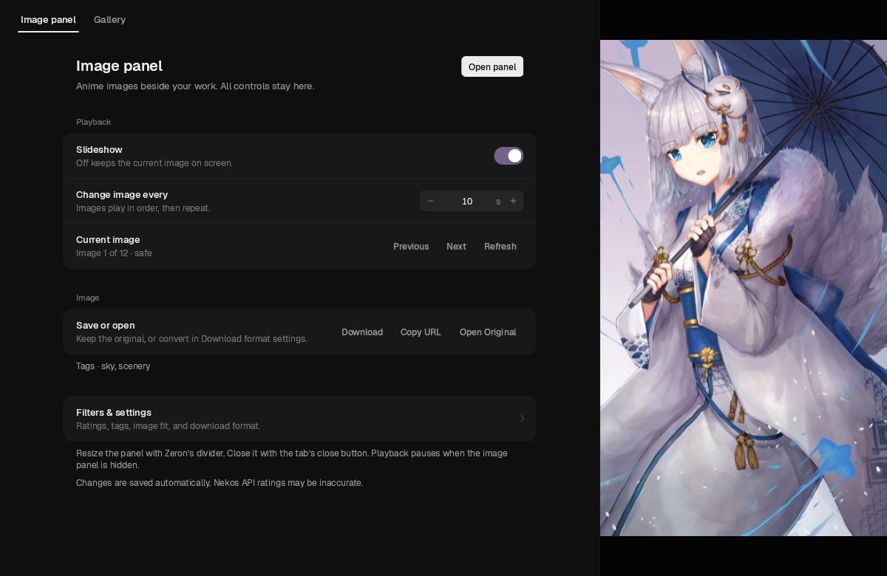

# Nekos Anime Images — Zeron v3

Version **2.0.0**. A native image panel, slideshow, and gallery for Zeron's desktop plugin system, checked against **v0.3.4**.

**No Python, Pillow, Tkinter, npm packages, external programs, or new runtime dependencies.** The plugin uses Luau, Zeron's SDK, zgx image rendering, and Zeron's existing web view for image export. It does not request permission to run commands.

## Install in Zeron

This repository contains **unsigned source**, not a ready-to-install `.zeron-plugin` package. Zeron rejects unsigned plugins when installing from a repository or package. To use this source on your own device:

1. Download this repository: select **Code → Download ZIP** on GitHub, then extract it.
2. In Zeron, open **Settings → Plugins** and open the plugins folder.
3. Copy the extracted repository folder into the plugins folder. Name it `nekos-api-anime-images`. The file `zeron-plugin.json` must be directly inside that folder, beside `init.luau`.
4. Sign the copied plugin with your device key. On Windows, while Zeron is running, open Command Prompt and run:

   ```bat
   start "" /wait "%LOCALAPPDATA%\Programs\Zeron\zeron.exe" plugin sign nekos-api-anime-images
   ```

   If Zeron shows an **It's mine…** option for the unsigned plugin, you can use that to sign it instead. For other platforms, see the [Zeron plugin guide](https://github.com/zeronsh/zeron/blob/v0.3.4/apps/zgx/docs/plugins.md).
5. In **Settings → Plugins**, enable **Nekos Anime Images** and allow its requested permissions. Open **Nekos Anime Images** in the sidebar, then select **Open panel**.

To update an older copy, disable it first and replace the whole plugin folder with the new source. Do not merge folders: old files must be removed. Sign the replacement again and review any permission changes. Plugin settings are stored separately from the source.

To share a signed package, sign the plugin on your device and run `zeron plugin export nekos-api-anime-images`. See `zeron plugin export --help` for the destination option. The current repository does not include a signed package.

## Preview



This is a native zgx component preview, not a capture of the packaged Zeron app. Zeron supplies the surrounding sidebar, tab header, and divider.

## Native image panel

- **Open panel** opens a real Zeron panel tab. Use Zeron's divider to change its width and its tab close button to close it. This version does not create a separate desktop window.
- The image area contains only the image. There are no plugin controls, captions, loading labels, or errors over it. Those stay in the **Image panel** control page.
- Turn **Slideshow** on for playback in batch order, then repeat. Turn it off for a static image. Set **Change image every** to 1–3600 seconds. The timer starts after an image loads. Playback pauses when the image panel is hidden.
- **Previous**, **Next**, and **Refresh** work from the control page. Refresh requests a new batch. Slideshow and interval changes are saved through `zeron.store`.
- **View → Open Nekos Image Panel**, **View → Nekos Image Panel Controls**, and **View → Open Nekos Anime Images** open panel tabs in the current chat. With no chat context, use the Nekos sidebar page. The gallery command also uses **Ctrl+Shift+G** on Windows/Linux or **Cmd+Shift+G** on macOS.
- The gallery's **Open panel** action sends its selected image and batch to the image panel. Image playback is shared between Nekos image tabs.

## Gallery and settings

Open **Gallery** for a responsive image grid or Single Image mode. Use **Refresh**, **Next Image**, **Load More**, **Download**, **Copy URL**, and **Open Original**. Artist, tags, rating, and source appear when supplied by the API.

**Filters & settings** opens Zeron's native plugin Settings page. Changes take effect at once. It provides content toggles, included and excluded tags, an optional artist, request size (1–100), duplicate avoidance, Gallery/Single mode, auto-refresh and interval, auto-load more, metadata, aspect ratio, download format, and slideshow defaults.

- **Enable NSFW** defaults to OFF. **Safe images** defaults to ON. All other ratings default to OFF. Turning the master switch off blocks `suggestive`, `borderline`, and `explicit`, even if their individual toggles remain selected. With no effective ratings selected, the plugin sends no request.
- **Hide NSFW previews** and **Blur NSFW thumbnails** default to ON. Hide takes priority: protected images are not sent to the renderer until **Reveal image** is selected in Zeron. If Hide is off and Blur is on, protected previews are blurred.
- A rating change clears old results and revealed states before loading a new batch. This also works while the image panel is hidden.
- **Nekos API ratings may be inaccurate.** A small tag block list skips some records that appear incorrectly marked Safe. It cannot detect all bad ratings.
- Auto-refresh runs while the view is mounted and Zeron is visible. Auto-load more applies to the gallery grid. Each view holds at most 300 results. Duplicate history is bounded to 1,000 image records.
- The saved setting IDs `floating_autoplay` and `floating_interval` are retained for upgrades. They now control the native panel's defaults. No floating-window code remains.

## Image formats and downloads

Zgx renders WebP directly. It also renders other formats supported by Zeron's image decoder. There is no PNG-only assumption or conversion for display.

**Original** preserves the downloaded bytes. **PNG** or **JPEG** also preserves bytes when the source already has that format. Otherwise, Zeron's existing web view performs canvas conversion, then the native Save dialog chooses the destination. JPEG uses white behind transparent pixels. Conversion of animation saves a still frame.

The exporter has no external scripts. It accepts only the listed Nekos image hosts, rejects redirects, uses a 15-second fetch timeout, limits downloads to 40 MiB, and limits conversion to 40 megapixels. The plugin checks that the selected image is still permitted before it starts the download and again after the Save dialog. Changing the selected image during a save cancels that save.

Export depends on the web view already supported by the Zeron build and the image host's cross-origin policy. If export cannot run, the plugin reports the error and offers **Open Original**. It does not install or launch another program.

## API

Requests use `GET https://api.nekosapi.com/v4/images/random` with URL-encoded `limit`, `rating`, and optional `tags` and `artist`. The checked v4 reference does not document `without_tags`; excluded tags are filtered locally. A batch can therefore contain fewer images than requested.

The plugin handles invalid responses, empty results, network errors, a 15-second timeout, and HTTP 429 with `Retry-After`. NSFW tests use synthetic metadata, not explicit image fixtures.

[Zeron plugin guide](https://github.com/zeronsh/zeron/blob/v0.3.4/apps/zgx/docs/plugins.md) · [Nekos API docs](https://nekosapi.com/docs) · [Checked v4 reference](https://git.moan.dev/nekos-api/nekos-api/src/commit/2c4ee129e1436f37e49a5dfdf957cca8e0f6b62b/README.md)

## Validation

The supplied source reports these checks for version 2.0.0:

- Luau compilation and zgx lint: **0 errors, 0 warnings** in plugin source.
- API rating gates, tags, limits, query encoding, metadata, empty/invalid payloads, and cooldown parsing.
- Four native UI tests: panel actions with no process bridge; ordered playback and saved controls; immediate NSFW blocking; rate-limit handling.
- Real WebP bytes loaded through a zgx host fetcher and native decoder. Playback advanced after decode and paused when the panel was hidden.
- Real plugin sandbox: entry loading, sidebar controls, page/session panel contexts, tab commands. The sandbox had no program-run capability.
- Upstream manifest validation and settings-store tests: defaults, immediate changes, and reload persistence.
- Export logic with a fake browser: original WebP bytes, no needless conversion, PNG/JPEG conversion flow, two-step download commit, HTTP errors, host and size restrictions. Canvas and browser download services were mocked in this test.

Not verified: the packaged Zeron app on Windows/macOS, the platform Save dialog, and real canvas output through the platform web view. The environment blocked the browser test process. The full Zeron build also remains blocked by an external ONNX Runtime download. These limits do not affect the passed Luau and native panel tests. The standalone UI harness emits existing upstream theme-token warnings; its metadata-only image fixtures are tested separately with the real decoder harness.

Development checks, from the plugin folder:

```sh
luau-compile --null *.luau tests/api.test.luau
zgx lint .
luau tests/api.test.luau
node tests/export.test.cjs
bash tests/run-ui.sh /path/to/zeron/apps/zgx/ui /path/to/zgx
```

These are development tools only. Users need only Zeron.
